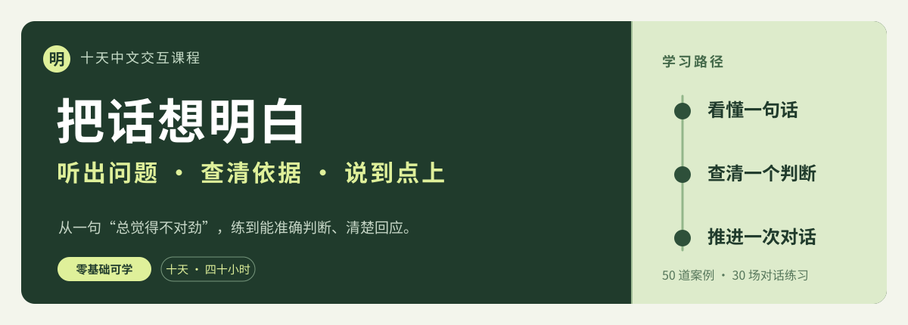

<p align="center">
  
</p>

<p align="center">
  <strong>零基础 · 全中文 · 10 天课程<br>50 道现实案例 · 30 场对话练习</strong>
</p>

<p align="center">
  <a href="https://hajimi-tomato.github.io/clear-thinking-course/"><strong>▶ 进入在线课程</strong></a>
  &nbsp;·&nbsp;
  <a href="#十天学习路线">查看十天路线</a>
  &nbsp;·&nbsp;
  <a href="https://github.com/hajimi-tomato/clear-thinking-course/issues">反馈问题与建议</a>
</p>

---

## 你是不是也遇到过

> “这句话听着不对，可我当场说不清哪里不对。”

比如有人说：“你没有秒回消息，所以你根本不重视这个项目。”你可能急着解释自己当时在忙，却忽略了这句话中最需要检查的一步：**回复速度能否单独证明重视程度？**

这门课从这样的现实对话出发。我们一起练习听出主张、追问依据、核对数字、辨别原因，也练习把自己的边界和建议说清楚。课程的目标是**判断更准确，让对话往前走**，而不是背熟术语后给别人贴标签。

## 跟我一起学：每天怎么走

每天按约四小时设计，你可以一次完成，也可以拆成几个时段。阅读时遇到高亮的专有名词，**悬浮或点击**就能查看中文解释；手机上轻触即可。

| 环节 | 建议时间 | 你会做什么 |
| :--- | :---: | :--- |
| **看懂** | 60 分钟 | 从白话例子认识当天知识点，看完整示范，做短小的穿插练习。 |
| **自己判断** | 60 分钟 | 先完成 5 道现实案例，再逐题展开解析，对照自己的思路。 |
| **开口练习** | 90 分钟 | 复制 3 套不同难度的角色设定到常用智能对话工具，多轮交流并逐句复盘。 |
| **带回现实** | 30 分钟 | 改写一次自己经历过的对话，再拆解一条外部信息或一个真实决定。 |

每一天都可以反复打开。答错题不是卡关：课程会解释**错在识别事实、推理连接，还是回应方式**。

## 十天学习路线

从[第一天](https://hajimi-tomato.github.io/clear-thinking-course/day-01.html)开始最顺畅；如果已有基础，也可以直接进入需要的主题。

| 天数 | 今天要解决的问题 | 学完带走什么 |
| :--- | :--- | :--- |
| [第 1 天 · 论证结构与隐含前提](https://hajimi-tomato.github.io/clear-thinking-course/day-01.html) | 对方的理由，真的能推出结论吗？ | “结论—理由—没说出的条件”拆解法。 |
| [第 2 天 · 概念与话题边界](https://hajimi-tomato.github.io/clear-thinking-course/day-02.html) | 同一个词，前后还是同一个意思吗？ | 澄清词义、确定范围、拉回议题。 |
| [第 3 天 · 信息与证据核查](https://hajimi-tomato.github.io/clear-thinking-course/day-03.html) | 一条消息有出处，就算被证实了吗？ | 区分事实与解释，追溯并交叉核查来源。 |
| [第 4 天 · 统计与概率直觉](https://hajimi-tomato.github.io/clear-thinking-course/day-04.html) | 数字是真的，结论就一定对吗？ | 查分母、样本、口径和绝对变化。 |
| [第 5 天 · 因果与竞争解释](https://hajimi-tomato.github.io/clear-thinking-course/day-05.html) | 先后发生，是否意味着一个造成了另一个？ | 提出其他解释，寻找能区分原因的证据。 |
| [第 6 天 · 困难对话与诡辩](https://hajimi-tomato.github.io/clear-thinking-course/day-06.html) | 被扣帽子、翻旧账时怎样不跑题？ | 承认真实关切，守住当前问题与边界。 |
| [第 7 天 · 条件与谈判](https://hajimi-tomato.github.io/clear-thinking-course/day-07.html) | “可以”“尽量”“以后再说”到底承诺了什么？ | 把任务、资源、期限和验收说成可执行约定。 |
| [第 8 天 · 认知偏误与自检](https://hajimi-tomato.github.io/clear-thinking-course/day-08.html) | 自己偏爱的判断，也经得起检查吗？ | 识别沉没成本、锚定与确认偏误，主动找反证。 |
| [第 9 天 · 不确定性下的决策](https://hajimi-tomato.github.io/clear-thinking-course/day-09.html) | 信息不全时，怎么做有根据的选择？ | 列选项、守风险底线、做事前验尸与决策记录。 |
| [第 10 天 · 复杂问题与清晰表达](https://hajimi-tomato.github.io/clear-thinking-course/day-10.html) | 多人争论、信息混乱时怎样推动下一步？ | 定义问题、拆解分歧、形成负责人明确的行动项。 |

### 一条贯穿十天的练习线

```text
听准对方说了什么
        ↓
检查依据是否足够
        ↓
说出关键问题或条件
        ↓
选择回应、追问或暂缓判断
        ↓
留下可执行的下一步
```

## 课程里可以直接操作什么

- **点词看解释**：高亮术语可悬浮、点击或用键盘聚焦；每天末尾另有术语表。
- **边学边做**：短题提交后显示具体反馈，改写题先写自己的版本再看示范。
- **先测后看**：每一天的五道案例都要求先作答，再展开该题解析。
- **练习真实表达**：每一天提供三场由浅入深的对话设定，可复制到常用智能对话工具。
- **继续学习**：作答内容和完成标记保存在当前浏览器，方便回来复习。

> **关于学习记录**：本站无需账号，也没有跨设备同步。答案和进度只存在你当前浏览器的本地存储中；更换设备、使用无痕模式或清除站点数据后，记录可能消失。智能对话练习需要在你使用的对话工具中进行，课程网页本身不提供在线聊天服务。

## 本地阅读与维护

直接用浏览器打开 `index.html` 即可从首页进入课程。课程页面是静态网页；在线字体不可用时，会自动使用系统中文字体。

| 文件 | 作用 |
| :--- | :--- |
| `index.html` | 首页与十天路线 |
| `day-01.html` 至 `day-10.html` | 十天课程页面 |
| `styles.css`、`script.js` | 共用样式与交互 |
| `course_content.py`、`build_course.py` | 第 2–10 天的内容源与页面生成脚本 |

调整第 2–10 天正文后，在仓库目录运行 `python build_course.py` 重新生成对应页面，再提交并推送。网站通过 GitHub Pages 发布。

## 内容依据与反馈

每一天页面末尾都列有对应的参考资料。课程编排参考了论证分析、信息核查、统计调查、困难对话与决策研究；案例为教学创作，不能替代具体的医疗、法律或财务建议。

发现解释不清、题目有歧义或页面无法操作？欢迎[提交问题或建议](https://github.com/hajimi-tomato/clear-thinking-course/issues)。描述是哪一天、哪道题，以及你认为哪里需要修改，后续维护会更容易定位。

---

<p align="center">
  <strong>先从一句话开始，把问题想明白。</strong><br>
  <a href="https://hajimi-tomato.github.io/clear-thinking-course/day-01.html">开始第一天 →</a>
</p>
